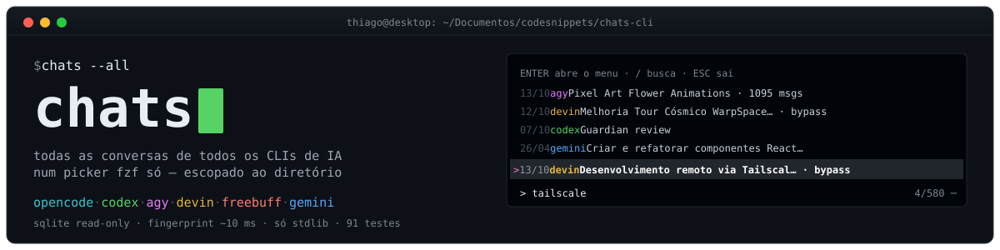

<div align="center">



**[Versão em português → README.pt-BR.md](README.pt-BR.md)**

</div>

# chats

Lists conversations from **every** AI CLI on the machine in a single screen,
scoped to the directory you're in — then opens them in the native CLI or imports
them into OpenCode.


**[▶ video demo — 30s](docs/demo.webm)** — real terminal footage: the fzf picker
with 120 conversations from 6 CLIs, fuzzy search + preview, the conversation
menu, `doctor`, and the fingerprint cache (~27 ms revalidation).

<video src="docs/demo.webm" width="720" controls muted></video>

## Features

- **Directory scoping** — inside a repo shows only that project's conversations;
  in `~` shows everything under `$HOME`, grouped by folder
- **fzf fuzzy search** over title + path, with a **conversation preview** pane
  on the right
- **Open natively** (`codex resume`, `devin -r`, `agy --conversation`, …) or
  **import into OpenCode** with dedupe and an idempotent ledger
- **Local index** with a per-source fingerprint — **~10 ms** revalidation
- **Dedupe marks** `⇄` (already imported) and `≡` (same conversation in 2+ CLIs)
- `doctor`, `sync`, `which`, `export` md/json — stdlib only; falls back to a
  numbered list when fzf is absent
- **Never writes to third-party databases**: every SQLite opens `mode=ro` +
  `busy_timeout`

## Supported sources

| source | reads from | resume with |
|---|---|---|
| `opencode` | `session_v2` (SQLite, `mode=ro`) | `opencode -s <id>` |
| `codex` | 1st line of each rollout | `codex resume <id>` |
| `agy` | `conversation_summaries.db` | `agy --conversation <id>` |
| `devin` | `sessions` + 8 nodes for the preview | `devin -r <id>` |
| `freebuff` | `chat-meta.json` | `freebuff --continue <dir>` |
| `gemini` | `~/.gemini/tmp/*/chats` | — (inactive CLI: `IneligibleTierError`) |

A missing or broken source becomes an `aviso:` on stderr — the other five keep
working.

## Usage

```sh
chats                     # fzf with the conversations of the current project/dir
chats                     # in home: everything under $HOME, grouped by folder
chats --all               # ignores the scope
chats --tree              # group by folder even outside home
chats --cli codex,devin   # only some sources
chats --since 7d          # time window (7d, 12h, hoje, 2026-09)
chats --format json       # for scripting
chats --no-pick           # table without opening fzf
chats which               # why this directory shows these conversations
chats doctor              # per-source health + fzf compatibility
chats sync [--force]      # revalidates sources, rewrites only what changed
chats preview <key>       # what fzf shows in the right pane
chats export <key> --to md|json [-o file]
chats open <key> --native [--dir <path>]
```

`<key>` = `<cli>:<id>`, e.g. `codex:01a10d84-4186-…`, `freebuff:codesnippets/2026-10-05T20-53-05.352Z`.

### Picker (fzf)

| key | action |
|---|---|
| `↑`/`↓` or `Ctrl-J`/`Ctrl-K` | move the selection |
| type | fuzzy search over date, cli, title and path |
| `Enter` | opens the conversation menu |
| `Esc` | quit |

Menu after `Enter`:

```
1  ▶  Open natively          codex resume <id>   (labels shown in pt-BR)
2  ⇄  Open in OpenCode       (imports and opens)
3  👁  Read in pager
4  ⧉  Copy id / command
0  ⬅  Back
```

Two marks on each line:

- `⇄` the conversation already exists in OpenCode (devin dedupe by
  `(title, directory)`)
- `≡` same conversation in 2+ CLIs — same folder, same first sentence, same day

## Directory scoping

| where you are | what shows up |
|---|---|
| `~` | everything under `$HOME`, grouped by folder |
| folder with a git repo | only the repo root and descendants |
| plain folder | itself and descendants |

`chats which` prints the applied rule, the resolved root and per-folder counts.

## Importing into OpenCode

`chats open <key> --opencode` sends
`POST /api/experimental/session/import` with `{info, messages, location}` —
`location.directory` **is required**: without it the session lands in the
`global` project and disappears from the listing.

- nonexistent directory (e.g. gemini pointing at a deleted repo) → refuses and
  asks for `--dir <path>`
- reimporting is a no-op: ledger in `~/.local/share/chats/imports.json` +
  existence check
- an already-imported devin conversation is detected by `(title, directory)`
  and the existing session is opened

## Local index (performance)

Each source's output lives in `~/.local/share/chats/index.db` and is only
re-read when its **fingerprint** changes — count + `mtime` (files) or count +
`MAX(column)` (SQLite), **~10 ms total**:

| | direct source | with index |
|---|---|---|
| warm | 262 ms | **77 ms** |
| cold (db pages out of cache) | 2 290 ms | **93 ms** |

- `chats sync` revalidates source by source: `atualizado` (updated) ·
  `reescrevido` (rewritten) · `sem mudar` (unchanged) · `erro`
  (`--force` rewrites everything; `--cli codex,devin` filters)
- `CHATS_SEM_INDICE=1 chats …` ignores the index — diagnostic toggle
- if the index fails (full disk, permissions, corrupt row) the scan reads the
  source directly: it's acceleration, never a dependency. Third-party databases
  stay untouched (`mode=ro`)
- start from scratch: `rm ~/.local/share/chats/index.db`

## Install

Requires **Python ≥ 3.10** (stdlib only) and optionally **fzf** on the `PATH` —
without it the numbered list takes over:

```sh
git clone https://github.com/thisux1/chats-cli && cd chats-cli
ln -sf "$(pwd)/chats" ~/.local/bin/chats
python3 -m unittest discover -s tests   # 91 tests, stdlib (no pytest)
```

## Layout

`chats_lib/{models,escopo,registry,store,render,picker,openers,cli,doctor,import_opencode}.py`
plus `chats_lib/adapters/{opencode,codex,agy,devin,freebuff,gemini}.py`. One
module per CLI exposing only `CLI`, `FONTES`, `scan()`, `carregar()`,
`resolver()`, `fingerprint()`; any failing source becomes a warning and the
rest keeps going.

## Known limitations

- `agy`: full content unavailable (schema-less protobuf) — the preview uses the
  database's `preview` column
- `gemini`: no resume command (inactive CLI); the menu shows the reason
- `freebuff`: aborted chats without `chat-meta.json` come in without content

Full plan, decisions and implementation findings (in pt-BR):
[`PLAN.md`](./PLAN.md).
